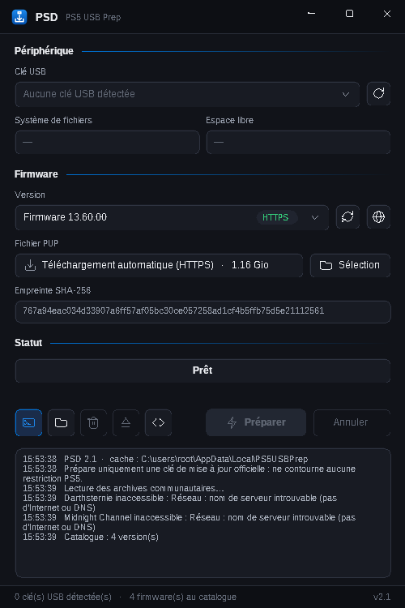
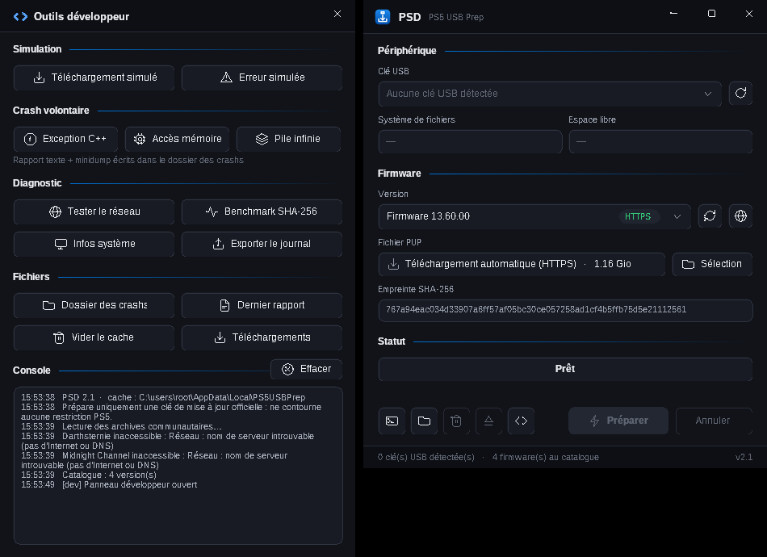

<p align="center"></p>

# PSD — PS5 USB Prep

Un seul `PSD.exe` (Windows 10/11 x64), sans installation : prépare une clé USB avec un firmware PS5 **Update** officiel, vérifié par SHA-256 du téléchargement jusqu'à la relecture sur la clé.

> Ne contourne aucune restriction : une PS5 peut refuser une version plus ancienne que la sienne.

<p align="center"></p>

## Télécharger
Onglet **Actions** → dernier build → artefact `PSD`. Les tags `v*` publient aussi l'exe dans **Releases**.

## Utilisation
1. Brancher la clé (détection automatique). NTFS/RAW → **Formater** (exFAT, droits admin).
2. Choisir le firmware, ou glisser un `.PUP` (version identifiée par son SHA-256).
3. **Préparer la clé** : téléchargement avec reprise, copie dans `PS5\UPDATE\PS5UPDATE.PUP`, relecture directe depuis la clé.
4. **Éjecter**, puis sur la PS5 : Paramètres › Système › Logiciel système › Mise à jour › Depuis une clé USB.

## Raccourcis
`F5` rechercher les clés · `Ctrl+O` choisir un PUP · `Ctrl+L` journal · `Ctrl+Maj+D` outils développeur · clic sur le SHA-256 pour le copier.

## Outils développeur
Bouton `</>` en bas (ou `Ctrl+Maj+D`) : panneau séparé avec console.
- Simulation : téléchargement de 256 Mio dans *Téléchargements* (avec coupure et reprise simulées), erreur simulée.
- Crash volontaire : exception C++, violation d'accès, débordement de pile. Rapport texte + minidump dans `%LOCALAPPDATA%\PS5USBPrep\crash`, signalé au lancement suivant.
- Diagnostic : test réseau, benchmark SHA-256, infos système, export du journal.
- Fichiers : dossier des crashs, dernier rapport, vider le cache, Téléchargements.

<p align="center"></p>

## Notes
- Cache : `%LOCALAPPDATA%\PS5USBPrep`.
- `sha256_references.json` (facultatif, à côté de l'exe) : empreintes supplémentaires.
- MEGA automatique si [MEGAcmd](https://mega.nz/cmd) est installé.
- Sources : [Darthsternie](https://darthsternie.net/ps5-firmwares/), [Midnight Channel](https://archive.midnightchannel.net/SonyPS/Firmware/index.php?cat=PS5SYS). Empreintes communautaires, pas une signature Sony.

## Tests
Voir [TESTING.md](TESTING.md) : 44 tests automatiques sous Wine dans GitHub Actions + checklist matérielle.

## Compiler
```sh
sudo apt install g++-mingw-w64-x86-64-posix binutils-mingw-w64-x86-64
./build.sh   # -> build/PSD.exe
```
